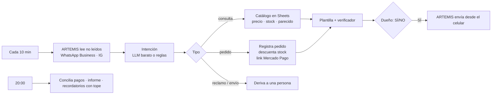

# Mostrador

**Agente de ventas con IA que atiende WhatsApp Business e Instagram desde un Android real.** Lee los mensajes con [ARTEMIS](https://github.com/google/artemis) (MCP), responde precio y stock desde una planilla de Google Sheets, registra pedidos, cobra con Mercado Pago y le hace seguimiento a los que no pagaron. Cada mensaje al cliente lo aprueba el dueño con un SÍ/NO.

Pensado para el comercio que vende por chat y no tiene sistema: un celular, una planilla y un link de pago.

```
📥 [whatsapp] Marta Gómez: Hola, cuánto el café molido de 500?
📝 Propuesta para Marta: "¡Hola Marta! Café molido 500 g a $9.800, hay stock. ¿Te lo preparo?"  → SÍ
📥 [whatsapp] Marta Gómez: Sí, dos
📝 Cobro para Marta: "¡Listo Marta! 2 x Café molido 500 g, total $19.600. Te paso el link de pago: https://mpago.la/…"  → SÍ
🔔 Informe 2026-10-10 — consultas sin cerrar: 0 · pedidos confirmados: 2 · cobrados: 1 ($19.600) · pendientes de pago: 1 ($10.500)
```

## Probalo en 1 minuto

```bash
npm install
npm run demo   # teléfono, planilla y pagos simulados; mismos módulos que producción
npm test       # 11 tests, incluido el adaptador de ARTEMIS contra un server MCP falso
```

## Cómo funciona



Ejemplo armado sobre una tienda ficticia, **Café del Sur** (café y accesorios), con 10 productos en `data/catalogo-demo.json`.

## Decisiones de diseño

**La plata la calcula el código, no el modelo.** El LLM solo clasifica la intención ("consulta", "pedido", "reclamo"…) y copia lo que nombró el cliente. Buscar el producto, el precio, el stock, el total y el link es código determinístico contra el Catálogo. Si no hay coincidencia clara, ofrece opciones en vez de adivinar.

**Verificador anti-alucinación como compuerta.** Si se activa la reescritura con LLM (`LLM_HUMANIZAR=1`), el texto pasa por `verificador.ts`: bloquea montos que no salen del Catálogo, links que no generó el sistema, productos fuera de la consulta, promesas de fecha de entrega y stock afirmado de un producto agotado. Si falla, se manda la plantilla, que siempre es correcta.

**Humano en el circuito, con salida gradual.** `FASE=propuestas`: todo pasa por SÍ/NO. `FASE=auto_simple`: se autoenvían solo respuestas de precio y stock verificadas. Cobros, seguimientos, reclamos y envíos van siempre con persona.

**Un celular, un turno.** Todo uso del teléfono pasa por una cola (`Turnos`): una tarea a la vez, como exige un único dispositivo.

**Puertos y adaptadores.** `Datos`, `Telefono`, `Pagos`, `Aprobador` y `LLM` son interfaces. Hoy hay Sheets/local, ARTEMIS/simulado, Mercado Pago/simulado, consola y cualquier API compatible con OpenAI. Sumar WhatsApp Cloud API o aprobación por WhatsApp es un archivo nuevo, sin tocar el pipeline.

**Barato y auditable.** Un modelo barato alcanza porque no decide nada crítico; hay tope diario de llamadas y, si se agota o falla, sigue con reglas. Cada propuesta, aprobación, envío y derivación queda en `logs/auditoria.jsonl`.

## Puesta en marcha real

**Fase 0 — Celular y ARTEMIS.** Android dedicado (o emulador) con WhatsApp Business e Instagram de la cuenta del negocio y depuración USB activada. En la PC: Python 3.12+, `uv` y `adb` (`adb devices` tiene que decir `device`). Instalá ARTEMIS siguiendo su README, cargá la clave de su modelo en su `.env` y verificá con `uv run artemis doctor`. Después corré `uv run artemis mcp --generate-config claude` y copiá `command`, `args` y `cwd` a `ARTEMIS_CMD`, `ARTEMIS_ARGS` y `ARTEMIS_CWD`. Nota: ARTEMIS instala un servicio de accesibilidad en el teléfono y lo mantiene despierto; por eso conviene un equipo dedicado.

**Fase 1 — Planilla.** Creá una Google Sheet con tres pestañas y estos encabezados en la fila 1:

| Pestaña | Columnas |
|---|---|
| Catálogo | sku · producto · precio · stock · foto |
| Pedidos | id · fecha · cliente · canal · items · total · estado · link_pago · notas |
| Seguimiento | pedido_id · próxima_acción · fecha |

Creá una cuenta de servicio en Google Cloud con la API de Sheets habilitada, guardá su JSON en `credenciales/cuenta-servicio.json`, compartí la planilla con el email de la cuenta y poné el ID en `SHEETS_ID`.

**Fase 2 — Reglas y cobros.** Ajustá `config/reglas.md` al negocio. Para cobrar, cargá `MP_ACCESS_TOKEN` (con usuarios de prueba de Mercado Pago mientras probás). Opcional: `LLM_API_KEY` para interpretar mensajes con un modelo.

**Fase 3 — Pruebas sin riesgo.** `cp .env.example .env`, completá y corré `npm start`. Usá una línea y cuentas de prueba, con amigos como clientes. Revisá `logs/auditoria.jsonl` para ver dónde falla y ajustá reglas.

**Fase 4 — Salida gradual.** Primero `FASE=propuestas`; cuando las respuestas de precio y stock salgan bien, `FASE=auto_simple`.

## Límites honestos

- WhatsApp e Instagram pueden restringir cuentas por actividad automatizada. Por eso: ritmo lento (cada 10 min), cuentas propias, y aprobación humana de cada mensaje.
- Donde hay API oficial conviene usarla: WhatsApp Cloud API, Instagram Messaging API, Mercado Pago. El celular es para lo que no tiene API. El puerto `Telefono` está para enchufar esas APIs sin reescribir nada.
- El stock se descuenta al confirmar (reserva). Si el cliente no paga tras `MAX_RECORDATORIOS`, se avisa al dueño para cancelar y devolver stock.
- El adaptador de ARTEMIS lee los nombres de argumentos del schema que publica el server, pero el formato del resultado puede cambiar entre versiones: si algo no parsea, `mobile_inspect_trace` muestra qué devolvió.

## Estructura

```
src/
  agente/      intención · catálogo · pipeline · redacción · verificador
  tareas/      ciclo cada N min · cierre de las 20:00
  telefono/    ARTEMIS (MCP) · simulado · turnos
  datos/       Google Sheets · local
  pagos/       Mercado Pago · simulado
  aprobacion/  consola · demo
  llm/         API compatible con OpenAI (OpenRouter por defecto)
config/reglas.md   reglas del agente
test/              verificador · pipeline · ARTEMIS con server MCP falso
```

## Próximos pasos

- Aprobación por WhatsApp (router + Evolution API) en lugar de consola.
- Adaptadores de WhatsApp Cloud API e Instagram Messaging API.
- Webhook de Mercado Pago para confirmar el pago al instante y mandar el comprobante.

## Licencia

MIT
